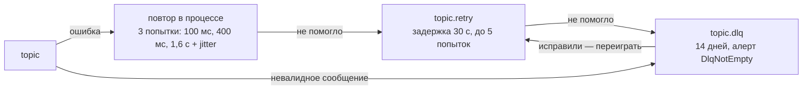

# События и Kafka

> Как домены обмениваются фактами: соглашения о топиках, формат сообщений, гарантии доставки, повторы,
> эволюция схем. Решение — [ADR-0004](../adr/0004-kafka-outbox-inbox.md); конфигурация —
> [`kafka.tf`](../../infra/terraform/kafka.tf), [`create-topics.sh`](../../infra/docker/kafka/create-topics.sh).

## 1. Соглашения

- **Имя топика:** `<домен>.<агрегат>.v<N>` (`leads.lead.v1`). Версия меняется только при несовместимом изменении,
  тогда старый и новый топики какое-то время живут параллельно (§7).
- **Ключ сообщения — id агрегата.** Все события одного агрегата попадают в одну партицию и читаются по порядку.
- **Тип события:** `<домен>.<агрегат>.<событие>.v<N>` (`leads.lead.created.v1`). Потребитель пропускает
  неизвестные типы (tolerant reader), поэтому добавить событие можно без координации.
- **Владелец топика — сервис-производитель.** Только он пишет в топик (ACL в Terraform). Читатели получают права
  явно, по одному топику.
- **В событиях минимум ПДн.** Передаются идентификаторы, а не телефоны. Превью сообщения для push ограничено 80
  символами, топик с ним хранится 3 дня.

## 2. Формат сообщения

Тело сообщения — protobuf-сообщение события ([`events.proto`](../../packages/proto/proto/masterly/events/v1/events.proto)).
Метаданные передаются в заголовках Kafka по CloudEvents 1.0 (binary mode), поэтому тело не нужно распаковывать
ради маршрутизации.

| Заголовок | Пример | Назначение |
|---|---|---|
| `ce_specversion` | `1.0` | Версия CloudEvents |
| `ce_id` | `0193…` (UUIDv7) | Уникальный id события, ключ дедупликации (inbox) |
| `ce_type` | `leads.lead.created.v1` | Тип и версия события |
| `ce_source` | `leads` | Сервис-производитель |
| `ce_subject` | id агрегата | Совпадает с ключом сообщения |
| `ce_time` | `2026-10-28T19:04:11.512Z` | Время факта (RFC 3339) |
| `content-type` | `application/x-protobuf` | Кодировка тела |
| `ce_schemaversion` | `1` | Версия схемы внутри типа |
| `traceparent` | `00-…-…-01` | W3C Trace Context: трейс продолжается в потребителе |
| `x-retry-count`, `x-retry-after`, `x-consumer-group`, `x-error` | | Только в `.retry` и `.dlq` (§5) |

`EventEnvelope` из proto — тот же набор полей одним сообщением. В этом виде событие хранится в outbox и выгружается
инструментами DLQ и переигрывания.

## 3. Топики

Партиции указаны для прода, в staging их в 4–8 раз меньше при той же топологии.

| Топик | Партиции | Хранение | Ключ | Производитель | Потребители | События |
|---|---|---|---|---|---|---|
| `identity.account.v1` | 12 | 30 дней | user_id | identity | catalog, leads, reviews, messaging, notifications, media, analytics, trust | `AccountDeletionRequested`, `ConsentChanged` |
| `catalog.master.v1` | 24 | compact | master_id | catalog | search, trust | `MasterUpserted` (полный снимок), `MasterDeleted` + tombstone |
| `reviews.rating.v1` | 12 | compact | master_id | reviews | search | `RatingAggregated` |
| `leads.lead.v1` | 48 | 7 дней | lead_id | leads | reviews, messaging, notifications, analytics | `LeadCreated`, `LeadResponded`, `LeadStatusChanged`, `ContactRevealed` |
| `reviews.review.v1` | 12 | 7 дней | master_id | reviews | notifications, trust | `ReviewCreated` |
| `messaging.message.v1` | 48 | 3 дня | conversation_id | messaging | notifications | `MessageSent` |
| `media.asset.v1` | 12 | 7 дней | asset_id | media | trust | `MediaUploaded` |
| `trust.moderation.v1` | 12 | 7 дней | subject_id | trust | catalog, reviews, notifications | `ModerationDecided` |
| `analytics.events.v1` | 96 | 3 дня, zstd | user_hash | gateway | analytics | `ProductEvent` |
| `analytics.search.v1` | 48 | 3 дня, zstd | search_id | search | analytics | `SearchPerformed` |

У каждого потребляемого топика есть `<topic>.retry` (3 дня) и `<topic>.dlq` (14 дней). Terraform создаёт их
автоматически. Число партиций — с запасом ×10 к расчётной нагрузке ([capacity-planning.md](capacity-planning.md#kafka)).

Пояснения к выбору ключа:
- **`reviews.review.v1` — по `master_id`, а не по отзыву.** Все отзывы мастера приходят одному экземпляру trust,
  и скорость появления отзывов (признак накрутки) считается локально, без распределённого состояния.
- **`ContactRevealed` без заявки** публикуется с ключом `master_id`. Порядок относительно событий заявки для него
  не важен.

### Типы событий и снимки

- **`catalog.master.v1` — event-carried state transfer.** Каждое сообщение содержит полный актуальный профиль,
  топик компактируется. Новый потребитель (или пересборка индекса) читает топик с начала и получает всё текущее
  состояние без обращений к catalog.
- **Удаление в компактированном топике.** `MasterDeleted` и следом tombstone (пустое тело). Сжатие уберёт ключ
  через `delete.retention.ms`. Срок `max.compaction.lag.ms = 7d` гарантирует, что данные удалённого профиля
  физически исчезнут из Kafka не позже чем через неделю.
- **`leads.lead.v1` — доменные события-факты** (дельты). Состояние заявки — в БД leads.

## 4. Гарантии доставки

**At-least-once + идемпотентные потребители = эффективно ровно один раз.**

### Производитель: transactional outbox

Событие записывается в таблицу `outbox` в той же транзакции, что и изменение данных. Отдельный relay публикует его
в Kafka. Двойной записи (БД + Kafka) нет: если транзакция откатилась, события не было. Если упал relay, событие
будет опубликовано позже.

```sql
CREATE TABLE outbox (
  seq           bigint GENERATED ALWAYS AS IDENTITY,
  id            uuid        NOT NULL,              -- ce_id (UUIDv7)
  shard         smallint    NOT NULL,              -- hash(key) % 16
  topic         text        NOT NULL,
  key           text        NOT NULL,              -- id агрегата
  type          text        NOT NULL,
  payload       bytea       NOT NULL,              -- protobuf
  headers       jsonb       NOT NULL DEFAULT '{}', -- traceparent и пр.
  created_at    timestamptz NOT NULL DEFAULT now(),
  published_at  timestamptz,
  PRIMARY KEY (seq, created_at)
) PARTITION BY RANGE (created_at);                  -- секция в сутки, старые удаляются целиком
CREATE INDEX outbox_pending ON outbox (shard, seq) WHERE published_at IS NULL;
```

Relay (в каждом поде сервиса) в цикле проходит 16 шардов, начиная со случайного:

```sql
BEGIN;
SELECT pg_try_advisory_xact_lock(hashtext('outbox'), :shard);   -- занят другим подом → следующий шард
SELECT seq, id, topic, key, type, payload, headers
  FROM outbox WHERE shard = :shard AND published_at IS NULL
  ORDER BY seq LIMIT 500;
-- producer.sendBatch(acks = all, idempotent) — ждём подтверждения брокеров
UPDATE outbox SET published_at = now() WHERE seq = ANY(:seqs);
COMMIT;
```

- **Порядок внутри агрегата сохраняется.** Шард обрабатывает один relay. `seq` выдаётся при вставке, а для одного
  агрегата порядок вставок совпадает с порядком коммитов: транзакции над агрегатом сериализуются блокировкой его
  строки.
- **Сбой между отправкой и `UPDATE`** даёт повторную публикацию. Её отсекает inbox потребителя.
- **Частота опроса адаптивная:** 50 мс при непустой очереди, 500 мс при пустой. Метрика `outbox_pending_events`
  с алертом `OutboxBacklog` показывает, что relay не успевает или Kafka недоступна.
- **Почему не CDC (Debezium / Data Transfer).** Опрос не требует слотов логической репликации. Брошенный слот
  растит WAL и угрожает диску managed-кластера. Опрос работает через пулер и одинаково ведёт себя локально и
  в облаке. CDC — вариант на будущее, если задержка опроса станет заметной.

### Потребитель: inbox

```sql
CREATE TABLE inbox (
  consumer      text        NOT NULL,
  event_id      uuid        NOT NULL,                -- ce_id
  processed_at  timestamptz NOT NULL DEFAULT now(),
  PRIMARY KEY (consumer, event_id)
);
```

В одной транзакции с эффектом выполняется `INSERT INTO inbox … ON CONFLICT DO NOTHING RETURNING 1`. Если строка
не вставилась, событие уже обработано, и оно пропускается. Эффекты вне БД дедуплицируются своими ключами:
отправка уведомления — `deliveries.dedupe_key`, запись в OpenSearch — внешняя версия документа, вставка в
ClickHouse — `insert_deduplication_token`. Записи inbox старше 14 дней (срок хранения DLQ) удаляются
фоновой задачей батчами.

### Параллелизм

Партиции обрабатываются параллельно (`partitionsConsumedConcurrently`). Внутри батча сообщения группируются по
ключу: разные агрегаты обрабатываются конкурентно, события одного агрегата — строго по очереди. Offset
коммитится после обработки всего батча.

## 5. Повторы и DLQ



- **Классификация ошибок.** Временные ошибки (таймаут, недоступность, конфликт блокировки) повторяются.
  Постоянные (не разбирается protobuf, нарушен инвариант) сразу уходят в DLQ.
- **Retry-топик общий для всех групп** потребителей исходного топика. Адресат указан в `x-consumer-group`,
  остальные группы такие сообщения пропускают. Повторов меньше 0,1 % трафика, поэтому это дешевле, чем
  отдельные топики на каждую пару «топик × группа».
- **Фиксированная задержка** (30 с) сохраняет FIFO в retry-топике. Потребитель приостанавливает партицию до
  `x-retry-after`, а не спит в обработчике.
- **Зависимость лежит целиком** (circuit breaker открыт) — потребитель ставит на паузу партиции основного топика.
  Сообщения ждут на месте и не перетекают в DLQ, лаг растёт и виден в алерте.
- **Порядок при повторах.** Если событие агрегата ушло в retry, следующие события этого ключа тоже идут в retry,
  пока ключ не очистится (список «припаркованных» ключей хранится в Redis). Для снимков (`MasterUpserted`) это
  не нужно, там защищает версия.
- **DLQ — не свалка.** Каждое сообщение порождает алерт. Админ-инструмент показывает тело, ошибку и трейс и
  позволяет переиграть сообщение (обратно в retry со сброшенным счётчиком) или закрыть его с комментарием.

## 6. Масштабирование потребителей

- Группа потребителей = имя сервиса (`notifications`). Для retry-топиков — отдельная группа `<сервис>.retry`.
- **KEDA** масштабирует по лагу: `lagThreshold = 2000` сообщений на под, максимум подов не больше числа партиций
  ([`values/*.yaml`](../../infra/helm/values)).
- Потребители живут в отдельном пуле узлов `consumers` и не конкурируют с онлайн-запросами.
- **SLO свежести** проверяются по метрике лага и e2e-пробам: индекс поиска ≤ 30 с (p99), уведомление о заявке
  ≤ 10 с (p95), аналитика в ClickHouse ≤ 2 мин.

## 7. Эволюция схем

| Изменение | Совместимо? | Как делать |
|---|---|---|
| Новое поле | Да | Новый номер поля; старые потребители его не видят |
| Удаление поля | Да, с оговоркой | Номер и имя — в `reserved`; потребители перестают читать поле заранее |
| Новый тип события | Да | Новый `ce_type`; неизвестные типы пропускаются |
| Смена типа или номера поля, смена смысла | Нет | Новый тип `…v2` или новый топик `…v2` |
| Смена ключа или числа партиций ключевого топика | Нет | Новый топик `…v2` |

- CI запускает `buf lint` и `buf breaking` против `main` (режим `WIRE_JSON`): несовместимое изменение не
  проходит ревью.
- **Миграция на `v2`.** Производитель пишет оба события через outbox (две строки в транзакции). Потребители
  переключаются по одному. Когда последний читатель `v1` ушёл и истёк срок хранения, `v1` удаляется.
- Схемы регистрируются в Schema Registry managed-Kafka. Он служит источником для инструментов (Kafka UI,
  будущий Kafka engine в ClickHouse), а тип и версию в сообщении несут заголовки CloudEvents.

## 8. Клиент Kafka

Сейчас используется KafkaJS: чистый JS, без нативных зависимостей в distroless-образе. Его ограничения:

- **zstd** — нужен отдельный кодек. Продюсеры сжимают gzip, брокер перепаковывает в zstd по настройке топика.
  Это стоит CPU брокеров, но экономит диск и трафик репликации ×3.
- **Rebalance** — только eager, без cooperative-sticky и static membership.
- **Темп развития** библиотеки низкий.

Клиент спрятан за интерфейсом `EventBus` в `@masterly/platform`. Если упрёмся в эти ограничения, перейдём на
librdkafka-клиент (`@confluentinc/kafka-javascript`) без изменений в доменном коде.
