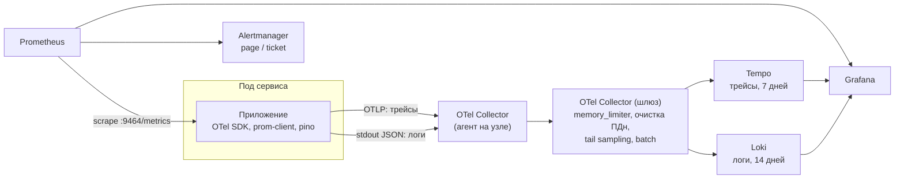

# Наблюдаемость

> По метрике должно быть видно, что сломалось, по трейсу — где, по логу — почему, а по ранбуку — что делать.
> Конфигурация: [`infra/docker/observability`](../../infra/docker/observability), [`otel/collector.yaml`](../../infra/docker/otel/collector.yaml).

## 1. Сигналы и конвейер

- **Метрики.** `prom-client` на порту `9464` (там же `/health/live` и `/health/ready`). Prometheus забирает их
  через `ServiceMonitor` из Helm-чарта. Гистограммы задержек несут exemplars с `trace_id`: из всплеска на
  графике можно перейти прямо в трейс.
- **Трейсы.** Автоинструментация HTTP, gRPC, pg, ioredis и KafkaJS. Tail sampling на шлюзе коллектора сохраняет
  все трейсы с ошибками, все медленнее 500 мс и 5 % остальных.
- **Логи.** pino пишет JSON в stdout с `trace_id` и `span_id`. Коллектор на узле читает файлы контейнеров
  и отправляет в Loki.
- **Очистка ПДн** работает в коллекторе (процессор `redaction` и регулярные выражения для телефонов и email) как
  второй рубеж. Первый рубеж — redact-пути pino в приложении (`authorization`, `cookie`, `phone`, `email`, `token`).

## 2. Сквозная трассировка через Kafka

Relay outbox кладёт `traceparent` исходного запроса в заголовок сообщения. Потребитель начинает свой span со
ссылкой (span link) на span производителя. В Tempo видна вся цепочка: `POST /v1/leads` → транзакция → публикация →
уведомление мастеру, даже если между шагами прошли минуты (тихие часы).

## 3. Каталог метрик

Эти имена используют [дашборды](../../infra/docker/observability/grafana/dashboards) и
[алерты](../../infra/docker/observability/alerts.yml). Их выставляет `@masterly/platform`, у всех метрик есть
метка `service`.

| Метрика | Тип | Метки | Что показывает |
|---|---|---|---|
| `http_server_requests_total` | counter | `method`, `route`, `code` | Rate и ошибки HTTP (шлюз, web) |
| `http_server_request_duration_seconds` | histogram | `method`, `route` | Задержка HTTP |
| `grpc_server_handled_total` | counter | `grpc_method`, `grpc_code` | Rate и ошибки gRPC |
| `grpc_server_handling_seconds` | histogram | `grpc_method` | Задержка gRPC |
| `grpc_client_handled_total`, `grpc_client_handling_seconds` | counter, histogram | `target`, `grpc_method`, `grpc_code` | Вызовы зависимостей глазами клиента |
| `kafka_consumergroup_lag` | gauge | `group`, `topic`, `partition` | Отставание потребителей (high watermark − закоммиченный offset) |
| `kafka_messages_consumed_total`, `kafka_messages_produced_total` | counter | `topic` | Поток событий |
| `kafka_dlq_messages_total` | counter | `topic` | Сообщения, ушедшие в DLQ |
| `outbox_pending_events` | gauge | — | Неопубликованные события в outbox |
| `outbox_publish_lag_seconds` | histogram | — | От коммита транзакции до подтверждения Kafka |
| `cache_requests_total` | counter | `cache`, `result` (`hit`, `miss`, `stale`, `error`) | Эффективность кэшей |
| `circuit_breaker_open` | gauge | `target` | 1 — breaker открыт |
| `db_pool_connections` | gauge | `state` (`idle`, `used`, `waiting`) | Насыщение пула |
| `rate_limit_rejections_total`, `load_shed_total` | counter | `route_class`, `priority` | Срабатывание защиты от перегрузки |
| `nodejs_eventloop_lag_seconds`, `process_*` | gauge | — | Стандартные метрики Node.js |
| `search_requests_total` | counter | `city`, `result` (`found`, `empty`) | Доля запросов без результатов |
| `leads_created_total` | counter | `city`, `service_id` | Бизнес-поток заявок |
| `lead_first_response_seconds` | histogram | `city` | Скорость ответа мастеров |
| `contact_reveals_total` | counter | `city` | Клики по контактам |

**Правила кардинальности.** В `route` — шаблон маршрута (`/v1/masters/{slug}`), никогда не фактический путь.
Идентификаторы пользователей, мастеров и заявок в метки не попадают, для этого есть трейсы и ClickHouse.
Число значений `city` и `service_id` ограничено справочниками.

## 4. Логи

- **Уровни.** `error` — требует внимания человека. `warn` — деградация, обработанная автоматически (сработал
  fallback). `info` — жизненный цикл (старт, миграции, ребаланс). `debug` по умолчанию выключен и включается
  флагом на под.
- **Структура.** Каждая запись — JSON с полями `service`, `version`, `trace_id`, `span_id`, `msg`, `err`
  (стек только для `error`).
- **Без ПДн и тел запросов.** Для отладки конкретного запроса есть трейс.
- **Хранение.** 14 дней в Loki. Аудит действий персонала — отдельный журнал ([security-privacy.md](security-privacy.md#11-аудит-и-инциденты)).

## 5. SLO и алерты

| SLO | SLI | Цель | Окно |
|---|---|---|---|
| Доступность API | Доля ответов шлюза без 5xx | 99,95 % | 30 дней |
| Задержка поиска | p95 `route="/v1/search"` | < 250 мс | 10 мин |
| Доступность записи | Доля успешных `POST /v1/leads` | 99,9 % | 30 дней |
| Свежесть индекса | Доля изменений профиля, видимых в поиске за 30 с | 99 % | 7 дней |
| Доставка уведомлений | Доля уведомлений вне тихих часов, отправленных за 10 с | 95 % | 7 дней |

Алерты по доступности построены по методике **multi-window, multi-burn-rate** (Google SRE Workbook):

| Алерт | Условие | Сожжено бюджета | Уровень |
|---|---|---|---|
| `ApiErrorBudgetFastBurn` | Burn rate > 14,4 за 1 ч и за 5 мин | 2 % за час | page |
| `ApiErrorBudgetSlowBurn` | Burn rate > 6 за 6 ч | 5 % за 6 часов | ticket |
| `SearchLatencyP95High` | p95 поиска > 250 мс 10 мин | — | page |
| `OutboxBacklog` | > 10 000 неопубликованных событий 5 мин | — | page |
| `KafkaConsumerLagHigh` | Лаг группы > 50 000 10 мин | — | ticket |
| `DlqNotEmpty` | Новые сообщения в DLQ за 15 мин | — | ticket |

Короткое окно в быстром алерте нужно, чтобы алерт гас сразу после починки, а не через час. *page* будит
дежурного, *ticket* разбирается в рабочее время.

## 6. Дашборды

- **RED по сервисам** ([`services-red.json`](../../infra/docker/observability/grafana/dashboards/services-red.json)):
  rate, ошибки и задержка по маршрутам и gRPC-методам, лаг Kafka, outbox, кэш, breaker'ы.
- **USE по инфраструктуре:** узлы, пулы соединений, managed-хранилища (метрики Yandex Monitoring
  экспортируются в Prometheus).
- **SLO:** остаток бюджета ошибок и burn rate по каждому SLO.
- **Продукт** (Grafana → ClickHouse): поиски и доля пустых выдач, заявки, скорость ответа мастеров, конверсия
  поиск → профиль → контакт.

## 7. Ранбуки

### ApiErrorBudgetFastBurn

1. Дашборд RED шлюза: какие маршруты дают 5xx и с какими кодами gRPC от каких сервисов.
2. Была ли выкладка за последний час (Argo CD → история)? Если да, откатить GitOps-коммитом и разбираться
   после.
3. Открытые breaker'ы (`circuit_breaker_open`) показывают больную зависимость. Дальше — ранбук этой зависимости.
4. Если причина в перегрузке (`load_shed_total` растёт), проверить HPA и Cluster Autoscaler. Временно поднять
   `minReplicas` и выключить флагами дорогие функции.

### SearchLatencyP95High

1. Чья задержка: шлюза, search (`grpc_server_handling_seconds`) или OpenSearch (панель кластера)?
2. Упал hit ratio кэша выдачи (`cache_requests_total{cache="search"}`)? Причины — инвалидация, рестарт Redis,
   новый паттерн запросов.
3. В OpenSearch: очереди search thread pool, сборка мусора, перекос шардов (горячий город). Можно временно
   увеличить реплики индекса.
4. Включить флаг деградации (кэш популярных запросов, карта без кластеров), если p99 выходит за 1 с.

### OutboxBacklog

1. Доступна ли Kafka для этого сервиса: ошибки продюсера в логах relay, ACL, SASL?
2. Работает ли relay: в каждом поде есть строки `outbox relay` в логах, растёт `kafka_messages_produced_total`.
3. Не держит ли долгая транзакция строки (`pg_stat_activity`, `idle in transaction`)?
4. События не теряются, они в таблице. После восстановления relay догонит очередь. Следить, чтобы
   `outbox_publish_lag_seconds` вернулся к норме.

### KafkaConsumerLagHigh

1. Масштабировала ли KEDA потребителей до максимума? Если упёрлись в число партиций, это сигнал для
   [плана масштабирования](capacity-planning.md#8-когда-и-что-масштабировать-дальше).
2. Не стоят ли партиции на паузе из-за открытого breaker'а зависимости? Тогда чинить зависимость.
3. Нет ли ядовитого сообщения, которое бесконечно повторяется в процессе? Его выдаёт рост `x-retry-count`
   в retry-топике.

### DlqNotEmpty

1. Открыть сообщение в инструменте DLQ: тело, ошибка, трейс.
2. Ошибка в коде — исправить, выкатить и переиграть сообщения в retry. Ошибка в данных — закрыть с комментарием
   и при необходимости исправить данные у производителя.
3. DLQ должна быть пустой к концу рабочего дня.

## 8. Дальше

- Непрерывное профилирование (Pyroscope) для gateway и search.
- Синтетические пробы ключевых сценариев из внешней точки: поиск, профиль, заявка в тестовом городе.
- SLO-отчёт для мастеров: скорость появления изменений профиля в поиске.
