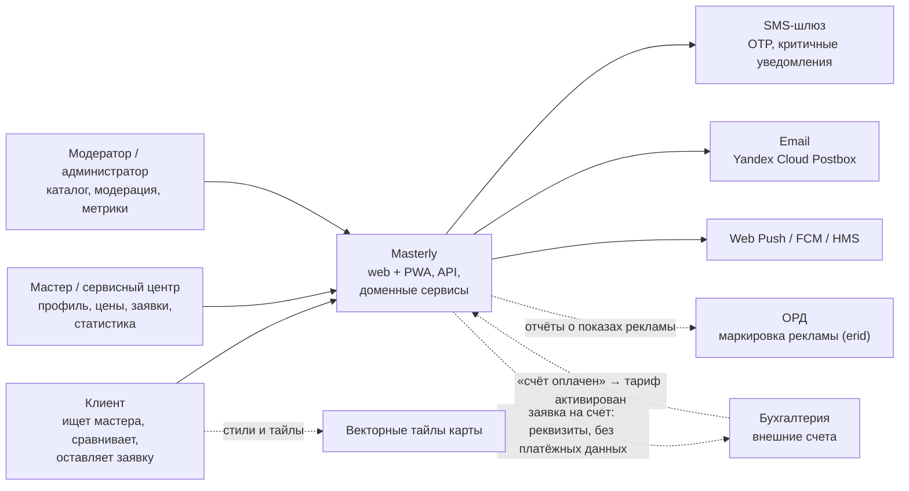
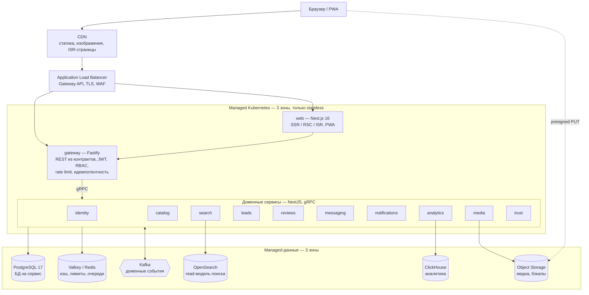
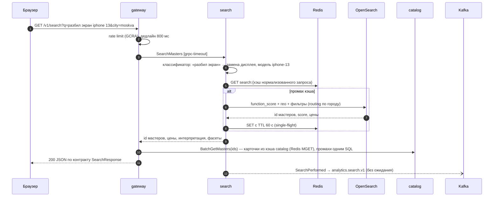
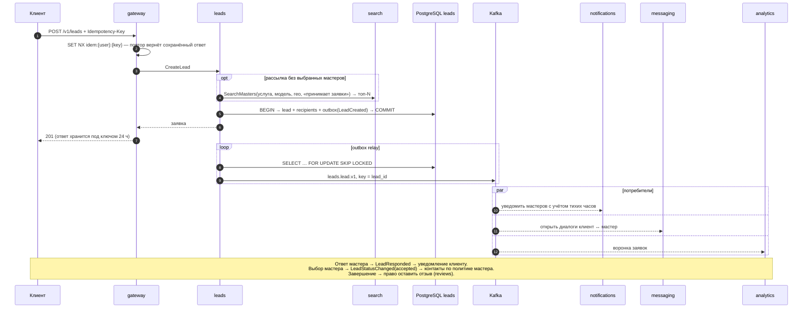
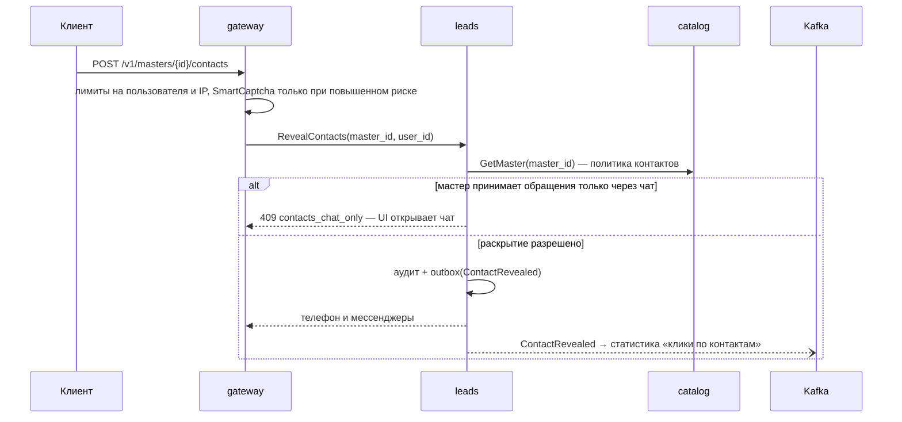
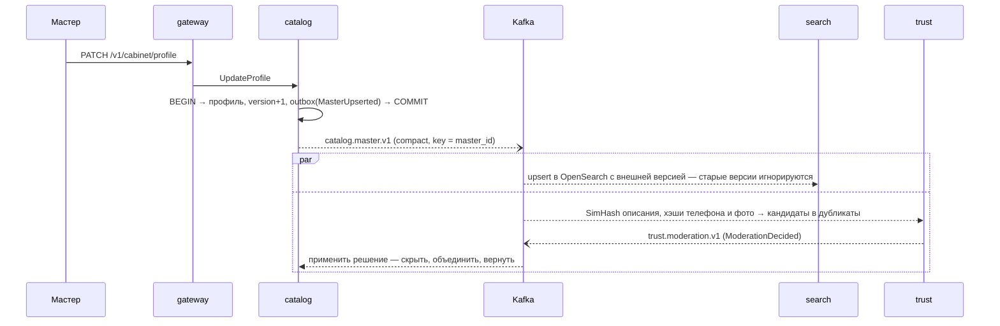

# Обзор архитектуры

> Статус: действует · Обновлено: 2026-10-28 · Решения фиксируются в [ADR](../adr/README.md)

## 1. Что строим

Masterly — платформа поиска проверенных мастеров. Клиент описывает проблему своими словами («разбил экран iPhone 13»)
и получает подходящих мастеров с ценой, сроком, гарантией и отзывами. Мастеров можно сравнить, а потом связаться
напрямую или оставить заявку. Мастер ведёт профиль, цены и расписание, получает заявки и видит статистику.
Платформа не берёт комиссию с ремонта и **не принимает платежей**: платные функции для мастеров оплачиваются по
внешним счетам ([ADR-0009](../adr/0009-no-payments.md)).

- **MVP:** ремонт смартфонов; Москва, Санкт-Петербург, Краснодар.
- **Проектная нагрузка:** треть нагрузки крупнейшего классифайда РФ — **25 000 RPS на шлюзе в пике**, из них около
  9 000 RPS поиска ([расчёт](capacity-planning.md)).
- **Расширение:** новые категории и города добавляются данными (справочники, синонимы, SEO-страницы),
  без изменения кода сервисов.

## 2. Принципы

1. **Контракт первичен.** Внешний REST описан zod-реестром [`@masterly/contracts`](../../packages/contracts). Из него
   строятся OpenAPI 3.1, типизированный клиент и mock-сервер. Внутренние вызовы и события описаны на Protobuf
   ([`@masterly/proto`](../../packages/proto)), совместимость проверяет `buf breaking` ([ADR-0003](../adr/0003-contract-first.md)).
2. **Сервис владеет своими данными.** У каждого сервиса своя БД. Чужие данные доступны только через API или события
   (event-carried state transfer). Общих таблиц и межсервисных JOIN нет ([ADR-0005](../adr/0005-postgresql-database-per-service.md)).
3. **Синхронно — только чтение на пути пользователя.** Побочные эффекты между доменами идут асинхронно через Kafka:
   transactional outbox на стороне отправителя и идемпотентные потребители ([ADR-0004](../adr/0004-kafka-outbox-inbox.md)).
4. **Вычисления без состояния, состояние в managed-сервисах.** В Kubernetes работают только stateless-поды.
   PostgreSQL, Kafka, Redis, OpenSearch и ClickHouse — managed-сервисы в трёх зонах ([ADR-0008](../adr/0008-yandex-cloud-managed-data.md)).
5. **Отказы закладываются в дизайн.** Дедлайн на каждом вызове, ретраи с бюджетом, circuit breaker и bulkhead.
   При сбое зависимости работа продолжается в упрощённом режиме ([resilience.md](resilience.md)).
6. **Приватность по умолчанию.** ПДн собираем по минимуму, контакты скрыты до явного действия, для поиска не нужна
   регистрация. Нет скрытого трекинга и платёжных данных ([security-privacy.md](security-privacy.md)).
7. **Наблюдаемость встроена.** Во всех сервисах подключён OpenTelemetry, trace context проходит через Kafka, на SLO
   настроены burn-rate алерты ([observability.md](observability.md)).
8. **Эволюция без «большого взрыва».** Версии в именах топиков и путях API (`v1`), миграции по схеме
   expand → contract, ADR на каждое значимое решение.

## 3. Контекст (C4, уровень 1)



## 4. Контейнеры (C4, уровень 2)



## 5. Сервисы

| Сервис | Отвечает за | Данные | Синхронный API | Публикует | Читает |
|---|---|---|---|---|---|
| **gateway** `:8080` | REST/BFF: маршруты из реестра контрактов, JWT (JWKS), RBAC, rate limiting (GCRA), идемпотентность, OpenAPI | Redis | REST `/v1/*` | `analytics.events.v1` | — |
| **identity** `:50051` | Вход по OTP, сессии, JWT EdDSA, ротация refresh-токенов, роли, согласия, экспорт и удаление аккаунта | PG `identity` | `IdentityService` | `identity.account.v1` | — |
| **catalog** `:50052` | Профили, филиалы, сотрудники, услуги и цены, модели устройств, зоны выезда, расписание, портфолио, верификация | PG `catalog` + PostGIS | `CatalogService` | `catalog.master.v1` | `trust.moderation.v1`, `identity.account.v1` |
| **search** `:50053` | Понимание запроса, ранжирование, гео и карта, подсказки, подбор мастеров для заявки | OpenSearch, Redis | `SearchService` | `analytics.search.v1` | `catalog.master.v1`, `reviews.rating.v1` |
| **leads** `:50054` | Заявки, получатели, ответы мастеров, статусы, раскрытие контактов | PG `leads` | `LeadsService` | `leads.lead.v1` | `identity.account.v1` |
| **reviews** `:50055` | Отзывы только по завершённым заявкам, ответы мастеров, байесовский рейтинг | PG `reviews` | `ReviewsService` | `reviews.review.v1`, `reviews.rating.v1` | `leads.lead.v1`, `trust.moderation.v1`, `identity.account.v1` |
| **messaging** `:50056` | Диалоги по заявкам, сообщения, отметки о прочтении; живой канал WebSocket `:8081` (`/ws`, Redis Pub/Sub между подами) | PG `messaging`, Redis | `MessagingService` | `messaging.message.v1` | `leads.lead.v1`, `identity.account.v1` |
| **notifications** `:50057` | Push / email / SMS / in-app, предпочтения, тихие часы, отложенная доставка (таблица доставок + SKIP LOCKED) | PG `notifications` | `NotificationsService` | — | `leads`, `messaging`, `reviews`, `trust`, `identity` |
| **media** `:50058` | Presigned-загрузки в Object Storage, проверка типа и размера, удаление EXIF, хэши для поиска дублей | PG `media`, Object Storage | `MediaService` | `media.asset.v1` | `identity.account.v1` |
| **analytics** `:50059` | Kafka → ClickHouse, отчёты мастерам, метрики платформы, пробелы каталога | ClickHouse | `AnalyticsService` | — | `analytics.*`, `leads.lead.v1`, `identity.account.v1` |
| **trust** `:50060` | Дубликаты профилей (SimHash + LSH, хэши телефонов и фото), накрутка отзывов, очередь и решения модерации | PG `trust` + PostGIS | `TrustService` | `trust.moderation.v1` | `catalog.master.v1`, `reviews.review.v1`, `media.asset.v1`, `identity.account.v1` |
| **web** `:3000` | Next.js 16: SSR/RSC, SEO-страницы (ISR), PWA | — | HTML / RSC | — | — |

Каждый сервис отдаёт `/health/live`, `/health/ready` и `/metrics` на порту `9464`. Порты, топики и права доступа
одинаковы в [Compose](../../infra/docker/compose.yaml), [Helm](../../infra/helm/values) и [Terraform](../../infra/terraform),
это проверяет `pnpm validate:infra`.

## 6. Ключевые сценарии

### 6.1 Поиск по проблеме



- OpenSearch хранит **read-модель**, а не источник истины. Индекс пересобирается из компактированного топика
  `catalog.master.v1` в новый индекс, после чего алиас переключается (blue/green, без простоя).
- Классификатор проблем (`@masterly/kernel`) понимает разговорные формулировки, опечатки, транслит и модели
  устройств. Запросы без результатов попадают в отчёт «пробелы каталога» (аналитика → админка).
- Платные карточки не смешиваются с органической выдачей: они стоят в отдельных слотах с пометкой «Реклама» и erid.
  Их показы считаются отдельно (`promoted_master_ids`).

### 6.2 Заявка — хореографическая сага



- **Идемпотентность двухуровневая.** Redis на шлюзе быстро отсекает повторы. Уникальный индекс
  `(client_id, idempotency_key)` в БД не даст создать дубль, даже если Redis потерял ключ.
- **Получатели выбираются до транзакции.** Заявка сохраняется сразу с адресатами, дальше сага движется событиями.
  Компенсирующие шаги — истечение (`expired`) и отмена клиентом. Они закрывают диалоги и снимают отложенные уведомления.
- **Отзыв возможен только после завершённой заявки.** reviews получает право на отзыв из `leads.lead.v1`, поэтому
  фейковые отзывы без реального обращения невозможны.

### 6.3 Раскрытие контактов



Телефон клиента мастер видит только при явном согласии (`sharePhone`, по умолчанию выключено). Иначе общение идёт во
встроенном чате.

### 6.4 Изменение профиля → поиск и модерация



Цель по свежести: изменение профиля видно в поиске за **≤ 30 с (p99)**.

### Живой чат и доставка уведомлений

```
клиент ──POST /v1/conversations/{id}/messages──► gateway ──gRPC──► messaging ──commit──► PG
                                                                       │
                                                       PUBLISH chat:user:<id>, chat:master:<id> (Redis)
                                                                       ▼
вкладка мастера ◄──WebSocket wss://masterly.ru/ws── любой под messaging (SUBSCRIBE на каналы своих сокетов)
        │
        └─ сигнал {conversationId} → инвалидация запроса → GET через шлюз (права и форма ответа — как обычно)
```

- **Сигнал, а не данные.** В сокет уходит только «в диалоге X новое сообщение». Авторизация и формат ответа
  остаются в одном месте (шлюз), а потерянный сигнал не теряет данные: Pub/Sub — at-most-once, история в PostgreSQL,
  клиент после переподключения дочитывает её запросом. Пока канал жив, опрос API редкий (страховка), без канала — частый.
- **Вход и защита.** Host-only cookie `mly_at` (поэтому WebSocket на том же хосте, что и сайт), проверка JWT по JWKS
  identity, белый список Origin (Cross-Site WebSocket Hijacking), до 8 соединений на пользователя, ping каждые 30 с,
  закрытие медленных клиентов (буфер > 1 МБ). К истечению токена сервер закрывает канал кодом 4001 — клиент тихо
  обновляет сессию и переподключается; при выкатке пода — код 1012 и переподключение с разбросом 0–5 с.
- **После коммита.** Сообщение пользователя публикуется после транзакции; системные сообщения по событиям заявки —
  после фиксации транзакции inbox и только при первой обработке события.
- **Уведомления по каналам.** notifications хранит только ленту и очередь доставок; адреса берутся в момент отправки
  у владельцев данных (identity — email и телефон пользователя, catalog — владелец мастерской). Email — SMTP
  (Postbox), SMS — HTTP-шлюз, push — Web Push с VAPID; подписки, отвергнутые браузером (404/410), удаляются.
  Временная ошибка провайдера — повтор с отсрочкой до 5 попыток, тихие часы переносят доставку на утро.

## 7. Технологии

| Слой | Выбор | Почему |
|---|---|---|
| Фронтенд | Next.js 16 (App Router, RSC, React Compiler), React 19, FSD | SSR и SEO-страницы по городам и услугам, потоковый рендеринг, строгие границы слоёв ([ADR-0002](../adr/0002-feature-sliced-design.md)) |
| Данные на клиенте | TanStack Query 5, nuqs, Zustand | Серверный кэш с SSR-префетчем, состояние фильтров в URL, локальное состояние (сравнение, избранное) |
| UI | Tailwind CSS 4, Radix, Motion, MapLibre GL | Токены темы, доступные примитивы, плавные анимации, векторная карта без вендор-лока |
| Контракты | zod 4 → OpenAPI 3.1; Protobuf (Buf v2, ts-proto) | Один источник истины для фронта, шлюза, mock-сервера и сервисов ([ADR-0003](../adr/0003-contract-first.md)) |
| Шлюз | Fastify 5 | Минимальные накладные расходы на 25k RPS, маршруты генерируются из реестра ([ADR-0010](../adr/0010-nestjs-services-fastify-gateway.md)) |
| Сервисы | NestJS 12, Node.js 22, TypeScript 6 | DI и модульность, gRPC-транспорт, единый каркас (`@masterly/platform`) |
| Хранилища | PostgreSQL 17 + PostGIS, Valkey/Redis, OpenSearch, ClickHouse, Object Storage | Каждое под свой профиль нагрузки ([ADR-0005](../adr/0005-postgresql-database-per-service.md), [0006](../adr/0006-opensearch-read-model.md), [0007](../adr/0007-clickhouse-analytics.md)) |
| События | Kafka (KRaft), transactional outbox, inbox | Надёжная доставка, повторное чтение, масштабирование потребителей по лагу ([ADR-0004](../adr/0004-kafka-outbox-inbox.md)) |
| Платформа | Yandex Cloud: Managed Kubernetes, managed-БД, KMS, Lockbox | Данные в РФ (152-ФЗ), три зоны, управляемые бэкапы ([ADR-0008](../adr/0008-yandex-cloud-managed-data.md)) |
| Поставка | Turborepo, GitHub Actions, Helm, Argo CD, Terraform, cosign, Renovate | Сборка только затронутого, GitOps, подписанные образы с SBOM, IaC |
| Наблюдаемость | OpenTelemetry, Prometheus, Tempo, Loki, Grafana | Открытые стандарты, сквозная трассировка, SLO-алерты |
| Тесты | Vitest, Playwright, Storybook + Chromatic, MSW, k6 | Модульные, e2e, визуальная регрессия, контрактные моки, нагрузка |

## 8. Дальше

- [Планирование мощностей](capacity-planning.md) — откуда 25 000 RPS и как они распределяются по ресурсам.
- [Данные](data.md) · [События](events.md) · [Устойчивость](resilience.md) · [Безопасность](security-privacy.md) · [Наблюдаемость](observability.md)
- [Дорожная карта](../roadmap.md)
